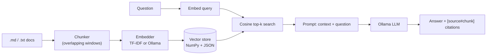
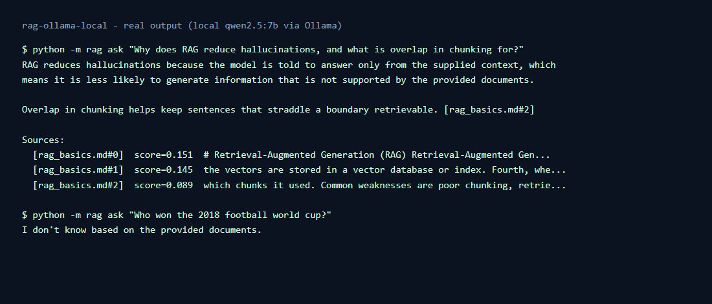

# Local RAG with Ollama

A small, readable **Retrieval-Augmented Generation** pipeline in Python that runs **entirely on your machine**:
chunk documents -> embed -> store vectors -> retrieve by cosine similarity -> answer with a local LLM via **Ollama**,
with source citations. No cloud APIs, no vector-database dependency - the vector store is ~40 lines of NumPy so every step is visible.



## Features
- **Two interchangeable embedders:** `tfidf` (pure NumPy, zero downloads - good for demos and tests) and `ollama`
  (semantic embeddings, default model `nomic-embed-text`).
- **Grounded answers:** the prompt tells the model to use only the retrieved context, cite chunks like `[rag_basics.md#2]`,
  and say "I don't know" when the answer is not in the documents.
- **Inspectable retrieval:** `--no-llm` shows the retrieved chunks and similarity scores without generating anything.
- **Tested offline:** 10 unit tests cover chunking, retrieval routing, ranking, persistence and the prompt (no Ollama needed).

## Quick start
```bash
pip install -r requirements.txt

# 1) Index the sample documents (no model download needed with the tfidf embedder)
python -m rag ingest docs/sample

# 2) See what gets retrieved (no LLM involved)
python -m rag ask "What is overlap in chunking for?" --no-llm

# 3) Ask with a local LLM (install Ollama first: https://ollama.com)
ollama pull llama3.2
python -m rag ask "Why does RAG reduce hallucinations?"

# Use a model you already have:
RAG_LLM_MODEL=qwen2.5:7b python -m rag ask "Why does RAG reduce hallucinations?"      # bash
$env:RAG_LLM_MODEL="qwen2.5:7b"; python -m rag ask "..."                              # PowerShell

# Interactive chat
python -m rag chat
```

### Better retrieval with semantic embeddings
```bash
ollama pull nomic-embed-text
python -m rag ingest docs/sample --embedder ollama
```
TF-IDF only matches shared words; semantic embeddings also match *meaning* ("car" ~ "automobile").

## Example
```
$ python -m rag ask "Why does RAG reduce hallucinations, and what is overlap in chunking for?"
RAG reduces hallucinations because the model is told to answer only from the supplied context ...
Overlap in chunking helps keep sentences that straddle a boundary retrievable. [rag_basics.md#2]

Sources:
  [rag_basics.md#0]  score=0.151  ...

$ python -m rag ask "Who won the 2018 football world cup?"
I don't know based on the provided documents.
```

## Screenshot


_Real output from a local run with `qwen2.5:7b` through Ollama (terminal text rendered as an image)._

## Project layout
```
rag/
  chunker.py     overlapping word-window chunking, directory loader
  embeddings.py  TfidfEmbedder, OllamaEmbedder
  store.py       VectorStore: cosine search, save/load
  llm.py         Ollama /api/generate client
  pipeline.py    RAG: ingest, retrieve, ask, prompt template
  __main__.py    CLI (ingest | ask | chat)
docs/sample/     small sample knowledge base (RAG, Ollama, model evaluation)
tests/           offline unit tests
```

## Run the tests
```bash
python -m unittest discover -s tests -v
```

## Limitations / next steps
- Brute-force search is fine for thousands of chunks; use FAISS/Chroma for much larger collections.
- Chunking is by words; sentence- or heading-aware chunking would keep structure better.
- Add retrieval evaluation (hit-rate / MRR on a small question set), a re-ranking step, PDF loading, and a simple web UI.
